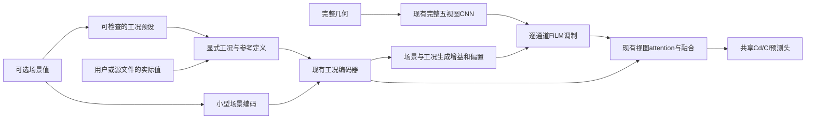

# 场景条件化气动系数模型方案

日期：2026-11-11。状态：A/B/C三组、三个种子各40轮的九次训练及统一评估已完成。用户已确认保留A（完整几何＋显式工况、不加场景）作为后续主线。B/C仅保留实验代码和权重，不作为默认方案。当前默认`scene_mode="none"`保持不变；未选择某个测试分数最好的种子替换既有预测入口。D等容量对照未执行，不单独归因调制机制与新增容量。

## 已确认的采用决定

2026-11-11，用户确认：“那保持A吧，报告记录下”。采用A的架构路线，继续保留完整五视图、显式工况、共享CNN与共享Cd/Cl头；不启用场景拼接或FiLM作为默认路径。

主要依据为A在车辆、飞机两领域的Cl和带符号Cl/Cd平均误差均最低。升阻比MAE按各来源等权后汇总，以下为三个种子的均值±标准差；数值是比值的绝对误差，非百分比：

| 方案 | 车辆Cl/Cd MAE | 飞机Cl/Cd MAE |
|---|---:|---:|
| **A：几何＋工况** | **0.153474 ± 0.015083** | **1.260001 ± 0.042000** |
| B：增加场景拼接 | 0.165183 ± 0.008400 | 1.338515 ± 0.102492 |
| C：增加场景＋FiLM | 0.164421 ± 0.012899 | 1.335866 ± 0.150304 |

A的飞机结果波动也最低；车辆B的种子波动更小，但平均误差较大。因此决定依据为综合误差权衡，不将A描述为所有指标的波动都最小。C的局部Cd收益保留在实验记录中，不据此切换默认模型。

执行范围：本次更新采用决定与报告，不重新训练、不修改冻结比较数据或九份实验权重、不删除B/C产物。原预测器及既有权重继续保留。可机器读取的决定见`outputs/aerodynamic-scene-abc-20261111/decision.json`。

2026-11-12用户另要求A的128维单种子对照及车辆常见细节探针，已完成；参见[宽度与后视镜敏感性记录](../../predict-vehicle-cd/references/learning-feature-width.md)。该试验仍不加场景，未改变本节的A架构采用决定或默认32维权重。

2026-11-12随后按用户确认补齐内置26车的标称工况输入：120 km/h、正常姿态0°迎角/偏航、移动地面和无滑移滚动车轮，均明确标为假设而非已核实源工况。新版数据另存`outputs/aerodynamic-builtin-assumptions-20261112/prepared/`，尚未重训；本报告第6节的冻结A/B/C及当日宽度对照仍使用旧数据中的缺失工况mask，分数和权重未改写。详情见[训练数据清单](aerodynamic-training-datasets.md)。

目标：以完整汽车或固定翼整机几何、显式物理工况及可选场景值预测Cd/Cl，检验场景提示能否提高领域内精度，并保持未知场景的共享预测路径。保留完整五视图和共享Cd/Cl头。

## 1. 工程师的场景经验如何映射

场景有两个独立用途：

1. 配置预设：推荐一组可检查、可覆盖的实际工况。例如道路车辆可推荐移动地面与旋转车轮；静止地板风洞须保留其实际配置。飞机外流可推荐无地面来流，仍须声明Mach/Re、迎角、侧滑、转捩、重力或推进等适用条件。
2. 模型调制：学习不同领域应如何利用几何和工况特征。场景选择可以改变通道的有效权重，但不能自动改变标签对应的物理设置。

训练工况从源文件读取，不使用预设将未知条件补写为已核实事实。推理时显式工况优先于预设，记录最终生效值及已知/缺失状态。源求解器、网格和收敛信息用于质量审计，首版不把数据来源ID变成场景ID。

首版只考虑`vehicle_external`（车辆外流）和`aircraft_external`（固定翼整机外流），不增加SUV、轿车或飞机子类。高速/低速由Mach/Re等连续条件表达；襟翼等几何状态由完整输入几何表达。缺省场景是训练中见过的共享路径，不宣称能可靠预测任意新物体。

## 2. 推荐结构：共享CNN与FiLM

对每个视图的CNN向量`f_v`应用：

`f'_v = (1 + a * delta_gamma_v(scene, conditions)) * f_v + a * delta_beta_v(scene, conditions)`。

乘法为逐通道操作；`a=0`表示未指定场景，保持原几何特征。场景编码缺省为零。工况编码和视图attention在缺省路径仍正常工作；该路径通过训练时随机隐藏场景提示学习，首轮候选比例为10%，不是未经训练的新类别。

调制输出层以零初始化，使初始变换为恒等变换。场景和工况改变通道增益与偏置，CNN卷积核、主预测头继续共享。在线性后续层中，对通道缩放相当于`W_eff = W * diag(gamma)`；首版不声称为每种场景生成任意完整权重矩阵。

建议首轮场景编码维数8，调制五个32维视图向量。调制器可用16维联合条件码→32维隐藏层→320个增益/偏置值；最终维数以统一输入实现为准。这部分约万级参数，准确规模与延迟在实现后测量。仍是一次前向，无迭代求解和完整专家网络。

若FiLM在受控实验中显露表达能力不足，再考虑小型低秩残差权重`W_shared + delta_W_scene`。只有明确观察到需要更多容量、且有足够独立几何后才考虑MoE；不在首轮同时加入这些结构，以便判断场景提示本身的价值。

该选择借鉴[FiLM](https://arxiv.org/abs/1709.07871)的条件化仿射变换。后续残差适配方向可参考[多视觉领域残差适配器](https://arxiv.org/abs/1705.08045)。这些论文不提供本项目气动精度收益的证据。

## 3. 统一输入与标签定义先行

当前车辆、COCOANet、HiLift和DrivAerRim分别训练，数值输入合同不同；不能直接拼接现有特征数组后开展公平联合实验。

统一时需要明确：

- Re及其参考长度；必要时换算为统一几何长度的Re，同时保留原定义和参考长度比例。
- Mach、迎角、侧滑及坐标/符号约定；由速度换算时必须有核实的流体状态和长度。
- 地面有无、间距、地面运动、车轮状态，以及来源中实际存在的转捩/推进/重力等物理条件。
- Cd/Cl所用参考面积和力轴。可采用统一系数参考约定，或显式表达`S_ref/L²`等参考量；不能让场景名代替面积定义。
- 缺失条件与假设条件须保留状态。现有内置26车仍属假设工况Cd标签；Cl损失掩码继续保留，不将其用于已核实工况的精度结论。

当前车辆模型实际上还输入四个来源/工况profile的one-hot位。新联合实验须先把其中的物理区别展开为明确条件；在该提案中，原profile保留为来源与条件审计元数据，不能直接改名充当场景ID。参考面积、Re与Mach会影响系数的解释，参见[NASA系数定义](https://www1.grc.nasa.gov/beginners-guide-to-aeronautics/drag-coefficient/)。

本版监督样本限定完整载具几何及其整机系数，独立机翼池不在此实验中混入。UAT候选池的短重启历史和转捩/重力合同需要先核验；不为增加样本数跳过这些已知问题。

## 4. 固定对照和验收

先冻结共同的数据池、输入/系数定义、几何分组、来源平衡策略、初始化和预算，再运行：

| 组别 | 设计 | 要回答的问题 |
|---|---|---|
| A | 共享网络，只有完整几何和物理条件 | 联合模型的基础效果 |
| B | A加场景编码，直接拼接进条件编码器 | 场景提示本身是否有信息价值 |
| C | B加上述FiLM，恒等初始化 | 显式通道调制是否优于仅拼接 |
| D（容量控制） | 与C同形的调制器，场景码恒为零，仅物理条件参与调制 | C的改进是否主要来自新增容量/条件调制 |

独立领域模型作为额外参照，使用相同的训练/评估成员和物理定义；已有不同合同的历史分数不能直接当成严格对照。首轮预算可沿用40轮、种子42/43/44；若先筛选结构，筛选只看验证集，不重复窥看测试集调参。

所有组采用相同的场景/来源采样预算。可从车辆/飞机各占50%的batch采样开始，再在领域内控制各来源权重，避免来源数量替代学习价值；这只用于训练采样，不增加模型类别输入。

每领域单列Cd/Cl MAE、P95误差、Cl符号错误和可用升阻比误差/有效数量；不只报告混合总平均。用构型族留出和来源留出评估新形状与来源迁移。已看过的历史测试只能称回归或重复使用的评估，不能称全新盲测。所有几何别名、同车多工况、镜像与近重复审计都需遵守统一分组；预训练权重不得包含实验留出几何。

补充诊断：仅场景+工况基准是否已能逼近结果；隐藏/打乱场景时模型依赖程度。错误标签实验仅用于依赖诊断，不能冒充真实物理条件下的准确率。

采用条件：多种子领域内指标相对A/B有一致收益，对其他领域和共享缺省路径无明显退化；给出每领域权衡和配对差值区间。改善幅度尚无实测，不预报百分比。网络前向延迟目标不超过对应共享基线的1.1倍，实际测量后决定；原始几何预处理耗时另计。

## 5. 对现有代码的最小落点

- `vehicle_cd_learning.model.CoefficientModel.encode`：复用现有五视图CNN、`parameter_encoder`和`ViewAttention`，在视图向量输出与attention之间加入唯一的场景调制模块，继续调用共享`head`。
- `CoefficientModel.encode_pooled`：若继续使用该真实消费者的缓存特征路径，必须复用同一个调制模块，保证原始输入/缓存输入计算一致；不能只改一条路径。
- 车辆`data/prepare/predict`和飞机`prepare/train/predict`：由原入口保存/读取场景与工况合同，新检查点单独保存；旧合同保持可加载。
- 原有`vehicle_cd_learning.train.train_model`继续拥有优化、验证集选权重和检查点写出。仅增加实际用到的场景输入/隐藏机制；不新增训练管理器、专家注册表或场景分类头。

本轮实际入口：`aircraft_learning.prepare_scenes`准备统一数据；`scene_experiment freeze/train`冻结协议并调用既有`train_model`；`compare_scenes`在九次训练完整通过成员/预算/初始化/采样一致性核验后才评估测试集。产物位于`outputs/aerodynamic-scene-abc-20261111/`。

## 6. 已冻结的三组对照

- 数据5554条；训练4121、验证614、历史测试819。完整几何视图2830组；同一飞机的不同工况共用视图，不能按记录数当作独立载具数。
- 20项原始数值条件/几何参数，加20个由已知状态派生的mask；未知及原26车的假设工况保留为None，按训练已知值归一化后以0占位、mask=0，不视为已核实数值。原26车仍全部在train-only，Cl缺失仍掩码。
- Windsor根据源侧向力转换为风轴Cd；不能直接将新分数与旧模型轴Cd分数比较。旧车512数值缓存按原相机行列公式最近采样到256，三组完全相同，不称重新光栅化。
- 原profile one-hot不输入；两场景为车辆外流/固定翼整机外流。地面、轮胎等实际设置与已知状态独立保留。20项不是完整NS边界描述，部分来源仍缺少黏度、Mach、转捩、重力等信息。
- 种子42/43/44，各40轮，batch32，AdamW学习率0.001，共享小型pyramid detail attention CNN及Cd/Cl头。随机初始化，不使用可能含留出几何的旧监督编码器。
- 同种子共享初始参数逐位配对，场景额外输入列初始为0，FiLM初始为恒等；A/B/C初始预测和物理样本/增强顺序已用实际小型CPU训练核验一致。B/C场景隐藏10%，使用独立RNG；训练来源平衡的采样RNG也独立。
- 每epoch采样数4121；车辆/飞机各50%，各自CFD来源等权；26车辅助来源占车辆预算5%。每个训练成员在40轮内实际被采样且三组曝光计数一致，将由采样RNG重放核验。
- 选权重使用两领域宏平均的验证MSE，目标按共同训练统计标准化。各领域及来源分别报告物理单位系数误差；所有九跑完成前不读取测试分数。历史切分已反复被查看，不称全新盲测或构型族留出测试。
- 协议冻结训练/模型/数据准备/评估代码SHA以及数据SHA；旧检查点继续保留。模型实现、数据转换和比较器的聚焦测试连同原回归共223项通过，Ruff/diff检查通过。

完整实测结果已写入同目录`comparison.json`、`README.md`、`comparison.png`，`final-verification.json`记录成员、采样与检查点核验。

## 7. 实测结果与采用判断

以下为三种子均值，每个领域内各CFD来源等权，数值越低越好；括号中为种子标准差。车辆测试227条、飞机测试592条。源内几何留出切分复用历史记录，不代表新车型/机型族盲测。

| 组别 | 车辆Cd MAE | 车辆Cl MAE | 车辆Cl/Cd MAE | 飞机Cd MAE | 飞机Cl MAE | 飞机Cl/Cd MAE |
|---|---:|---:|---:|---:|---:|---:|
| A：几何＋工况 | 0.010656 (0.001044) | 0.046545 (0.005761) | 0.153474 (0.015083) | 0.008519 (0.000684) | 0.068826 (0.003442) | 1.260001 (0.042000) |
| B：增加场景拼接 | 0.010358 (0.000519) | 0.050160 (0.002151) | 0.165183 (0.008400) | 0.009530 (0.001172) | 0.074654 (0.002606) | 1.338515 (0.102492) |
| C：增加场景与FiLM | 0.010150 (0.001160) | 0.050222 (0.004698) | 0.164421 (0.012899) | 0.008026 (0.000695) | 0.071842 (0.003950) | 1.335866 (0.150304) |

综合判断：没有证据支持将B或C作为Cd、Cl及升阻比的全面升级。A的两域Cl与升阻比误差最低。C相对A车辆/飞机Cd均值降低4.74%/5.78%，但Cl误差增加7.90%/4.38%，升阻比误差增加7.13%/6.02%；C的计算开销较小，当前主要问题是精度权衡。

稳定性与来源差异：

- C的车辆Cd在三个种子均改善，但来源内几何簇bootstrap改善区间[-0.000163,0.001152]跨0。飞机Cd的均值改善由seed44主导；seed42/43分别退化0.0000813/0.0003098，seed44改善0.0018686，不能称跨种子稳定改善。条件于这些模型的飞机Cd簇区间[0.000098,0.000867]不包含训练随机性或新构型族不确定性。
- HiLift上C的Cd三个种子均改善，均值降低9.25%；但Cl误差增加5.30%。COCOANet上C的Cd基本不变（误差增加0.26%），Cl增加3.97%、升阻比误差增加10.39%。车辆Ahmed的C Cl MAE/P95增加15.35%/约10.4%，Windsor Cl增加8.65%；Rim的Cd/Cl则都改善，不能只看混合总平均。
- B的车辆Cd仅小幅改善2.80%，车辆Cl误差增加7.77%；飞机Cd/Cl误差增加11.86%/8.47%，无综合采用优势。
- 未指定场景时，C飞机Cd/Cl宏平均MAE为0.009947/0.086836，相对其已指定场景路径退化约23.92%/20.87%；相对A也更差。场景隐藏训练保证路径存在，并不保证未知场景泛化精度。
- 三组正式及缺省路径在当前评估中均无非正Cd/无效升阻比样本；升阻比排序没有依赖过滤失败预测。

参数量A/B/C分别90173/90325/101429。缓存视图、batch1、MPS前向的三次中位耗时平均约5.93/5.85/6.30 ms；C相对A增加约6.2%，不含读网格、归一化和渲染。时延小差异不作严格加速结论。

最终核验：九跑完整40轮，训练ID、数据SHA、同种子共享初值、实际采样曝光计数和采样RNG均一致；原13份检查点及原两个主manifest哈希未改变。源数据仍有缺失/假设工况，三组没有等容量D对照。结果说明本次实现和预算下的取舍，不排除其他场景条件化结构或更完备数据上的收益。
