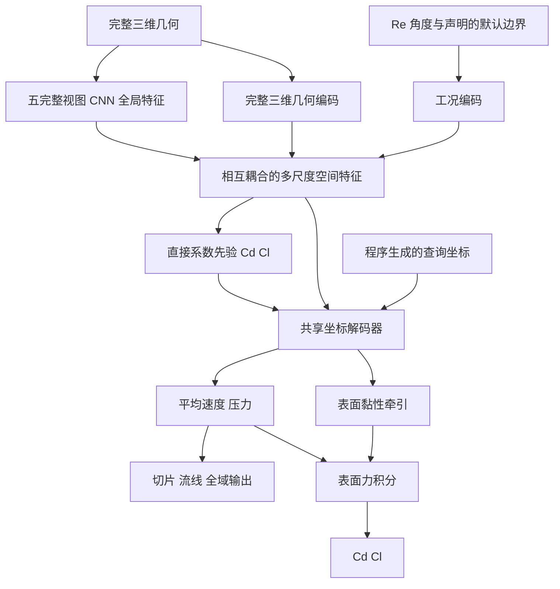

# 车辆平均流场神经网络开发计划

日期：2026-11-04。状态：已有实验性车辆场原型，本文同时记录后续目标；两者的差异见架构评审说明。

2026-11-05 架构评审方向：用户希望以整车/整机几何、Re 和角度作为主要输入，几何与工况相关的空间规律由网络内部学习；不向场网络额外输入人工计算的距壁距离或法向等派生特征。边界类型需明确，可为常用工况设置固定默认。A（系数反馈）与 B（仅共享隐表示）均已实现配对部分微调实验；三种种子的同集比较显示 A 小幅领先，差异区间仍跨零。用户已决定保留 A 作为后续主线，B 保留为实验对照。详见 vehicle-flow-weak-supervision.md。

同日 A 诊断发现壁面穿透、外边界速度误差和场积分 Cl 符号问题；单种子从 31 轮续训到 62 轮未达到替换条件，原权重保持不变。接下来优先处理边界约定、分区采样和多指标验收，之后扩大几何覆盖。实测与下一步实验约束见 [A 诊断报告](vehicle-flow-a-diagnostics.md)。

目标是从完整车辆几何和明确的边界条件预测一个共享的三维平均流动状态，并从中得到 Cd、Cl、切片、平均流线和完整计算域数据。采用多尺度空间特征和共享解码器，按需要的位置分批输出；网络参数不与 CFD 体网格单元逐个对应。

优先将已有车辆训练集接入共享几何编码、Cd/Cl 整体监督和物理约束训练。已有数据包括真实几何、完整视图、Re、工况描述与系数；它们可以用于新路线，无需等待完整场标签。需要先恢复原始几何、参考面积和可执行边界，并为平均流动定义相容闭合。完整场监督是可选增强和检验途径。完整体域和边界条件响应属于后续必需阶段。

## 1 最终交付范围

| 输入或输出 | 交付要求 |
| --- | --- |
| 车辆几何 | 接受现有支持的三维模型；明确单位、前向、上向、地面位置和部件标识；保留五个完整视角，不制作部件局部图 |
| 物理工况 | Re 或由速度、长度、黏度计算的 Re；来流方向；地面速度；车轮角速度；计算域及各边界类型和值；有数据时加入其他参数 |
| 共享流动状态 | 有空间位置的全局与局部特征，统一解码平均速度、压力；表面分支补充黏性牵引/剪应力 |
| 系数 | 从同一预测状态的表面压力与黏性牵引积分得到 Cd、Cl，保留压力和黏性分量、参考面积及力轴约定 |
| 可视化 | 压力/速度切片、表面云图、平均流线；显示量纲、图例、预测工况及支持范围 |
| 全域数据 | 对用户指定的有限流体域、规则采样网格或已有体网格分批输出；支持至少千万级查询点的内存受控处理 |
| 在线性能 | 秒级预测；新几何和工况的在线路径禁止权重优化、隐变量拟合或以残差收敛为终止条件的求解循环；按输入规模、硬件和输出产品分别验收 |
| 质量报告 | 分来源和分区域误差、守恒诊断、积分/采样稳定性、工况与几何适用范围、运行时间和峰值内存 |

首版目标为低速、统计稳定的平均外流场。瞬时湍流时间序列、任意新车型/工况的普适求解、瞬时涡结构、流固耦合、传热和声学需要独立数据与扩展项目。平均流线不解释为瞬时粒子轨迹。

## 2 当前起点

- 已有完整五视图深度/掩码渲染、几何比例和 Re 输入、CNN 与 attention、Cd/Cl 缺失标签掩码及按来源评估。
- 联合数据为 1,099 条训练、119 条验证、135 条历史 CFD 测试记录；26 辆内置车均在训练侧，仅有 Cd。历史测试结果已经查看过，后续称其为历史回归测试，不能声称新的盲测。
- 当前下载目录有 484 个 DrivAer、499 个 Ahmed、350 个 Windsor STL；尚无相应的 boundary/volume 流场文件。Windsor 原始文件数不等于去重后训练记录数。
- 26 辆车的 120 km/h、零偏航、运动地面、旋转车轮均为显式假设，不能升级为已核实的工况或场标签。
- 当前机器为 Apple M2 Pro、32 GiB 内存，2026-11-04 检查时可用磁盘约 265 GiB。适合开发和小样本验证，不按能直接加载任意完整 DrivAer VTU 规划。
- 已发现轮廓采样敏感性；低学习率对照未通过替换条件；采样增强训练未完成。它们提供候选实验依据，不作为新流场模型的既有精度。

阶段 0 冻结当前权重、数据、代码状态和结果哈希。已有未提交修改保持原样，不通过 reset、清理目录或覆盖输出恢复工作区。

## 3 架构与空间表示

几何编码只做一次；后续查询复用本次推理的空间特征。第一版用一个全域粗特征网格和一个车辆附近特征网格作为可测起点。可以从 32³ 和 64³ 的候选分辨率开始做显存基准，具体通道数和分辨率根据阶段 2 的实测冻结，不能把这些数值当成已证明足够的分辨率。

CNN 保留整车上下文，三维几何编码器从完整几何学习有空间位置的特征。场解码器不额外接收预先计算的距壁距离或法向作为特征；程序仍可由几何计算表面法向、积分面积和固体掩码，用于边界约束、后处理及输出有效性。学习目标扩展后，不能假定原来每视角 32 维的系数特征已经包含完整流场。只有在验证有收益时才保留迁移初始化；独立留出内置车时不得用已训练全部 26 车的联合权重初始化。

全域、车身附近、近壁和尾流层级之间交换信息。局部表征由网络根据完整几何和位置学习；推理阶段不能使用参考流场确定尾流或加密区域。各区域不独立求值后硬拼接。

主压力解码器同时提供体域和壁面压力迹。表面剪应力可以有专用输出头，但必须共享几何和流动状态，并检查与近壁速度及边界条件的一致性。所有几何尺寸和积分面积仍由真实几何提供。

B 候选移除“直接系数头预测值 → 场解码器”的依赖，场系数从同一预测场积分得到；A 则保留该预测先验。直接系数头可在训练中作辅助监督，使现有 1,099 条系数标签及 26 辆 Cd-only 车辆继续作用于共享几何编码器；这要求训练期允许对应共享编码器接收梯度。A/B 实验现已缓存投影层之前的特征，并解冻现有投影层、工况编码和视角 attention，辅助损失可更新共享编码；前部 CNN 保持冻结。缺失 Cl 仍保持掩码。新旧架构须比较场积分系数、旧数据贡献和物理误差，再决定是否保留。

参考实现方向为 [GINO](https://arxiv.org/abs/2309.00583) 的几何到隐网格映射及 [DoMINO](https://docs.nvidia.com/physicsnemo/latest/physicsnemo/examples/cfd/external_aerodynamics/domino/README.html) 的全局/局部几何编码和查询点预测。优先复现一个小型参考基线，然后决定是否值得自建；不预先把完整框架引入项目。

### 离线训练与在线预测

训练目标是跨几何、跨受支持工况的条件神经算子。离线在一组几何与边界条件上训练同一套权重；在线将新几何和工况直接编码为本案例的空间特征，并通过固定网络层和分批解码得到输出。不为新案例重新训练，也不通过优化潜变量寻找解。共享空间特征由编码器生成，不能依赖推理时未知的 CFD 场。

主线复用已有车辆几何和 Cd/Cl 标签，在跨几何、跨受支持工况的条件算子上施加整体系数监督及相容的方程、边界约束，可不使用预存 CFD 场标签；仍需独立参考检验精度。场监督在有对应数据时加入。为单个案例反复优化的 PINN 仅用于验证方程实现，不作为秒级上线方案。通道和制造解原型的用途限于检查方程及训练机制，后续开发回到已有车辆数据。

在线允许有限预算的几何采样、表面求积和流线后处理；这些计算不触发 CFD 收敛迭代。对超出支持范围的输入显式标记，不静默转入耗时的重训或数值求解。

## 4 数据来源与采集顺序

| 数据 | 首次使用范围 | 作用及边界 |
| --- | --- | --- |
| 现有联合车辆数据 | 原 1,099 训练、119 验证及历史 135 测试，保持切分和 26 车 Cd 掩码 | 优先作为新模型主数据入口；补回 source 几何及参考量，未提供的场标签不伪造 |
| AhmedML | 先取 1–3 个完整案例；通过数据门禁后固定一个官方小样本切分 | 简化几何，验证三维流场读取、查询和物理后处理；不代表量产车泛化 |
| DrivAerML | 先取 1–3 个表面案例；再扩到约 40–80 个训练案例和冻结留出集 | 整车表面和体域主线；沿用官方案例身份及可追溯版本 |
| WindsorML | 主流程稳定后引入 | 检验尾流、离地间隙及不同来源；保留偏航和模型轴系数定义 |
| 原 26 辆车 | 全部参与最终模型的 Cd 弱监督分支 | 缺失 Cl/场值始终掩码；其拟合单独报告 |
| 新配对 CFD | 多工况阶段设计采集 | 解耦同几何的 Re、地面、车轮和偏航变化 |
| DrivAerNet++ | 条件性扩展数据源 | 增加参数化车型覆盖；数据为 CC BY-NC 4.0，商业用途需要相应许可，非当前默认依赖 |

[DrivAerML 官方目录](https://huggingface.co/datasets/neashton/drivaerml)给出的典型表面文件约 500 MB、体域约 50 GB，总库约 31 TB；[AhmedML](https://huggingface.co/datasets/neashton/ahmedml)体域约 5 GB/案例。它们及 [WindsorML](https://huggingface.co/datasets/neashton/windsorml)标注 CC BY-SA 4.0。采集时锁定实际仓库 revision、文件大小和哈希，保留来源与许可。不同发布版本的新增文件单独核对，不悄悄替换旧标签。

1. 先列清单和预计大小，再按案例下载 boundary、volume、参考值和必要几何；设置磁盘配额、校验和及可恢复下载。
2. 对分片 VTU 按源文件顺序重组并核验完整性。VTU 读取器是否能分块必须实测；不能把下载分片直接当作独立空间分块。
3. 在具有足够内存的预处理环境中转换为按案例、按空间块读取的数组。推荐先比较简单分块文件和 Zarr，只有并发/压缩需求证明必要时才引入后者。
4. 保留固定评估点集、表面积分规则和少量完整原始案例。训练可动态抽样，评估不能随训练随机抽样改变口径。

## 5 数据与物理约定

每个案例只保存当前训练和推理实际需要的字段，不建立通用仿真元数据平台。记录以下内容及其来源：

- 案例/基础车型标识、几何与原始场文件哈希、split、求解方法、场的平均方式及可信度。
- 物理单位、到项目坐标系的变换、车身全长 L、参考面积 Aref、计算域边界、各边界类型和值。
- U、黏度或 Re、偏航、地面速度、轮胎半径和角速度；缺失、假设、核实状态显式区分。
- 场值位于 cell 还是 point、压力为 Pa 还是 p/ρ、剪应力是否除过密度、法向与流体对车身作用力的符号。
- 表面面积、体积或抽样积分权重；轮胎、车身、地面、远场等部件标签。

统一采用 x*=x/L、u*=u/U。若流体密度已知，p*=(p−p∞)/(ρU²)，因此 Cp=2p*；黏性牵引采用同一动压口径换算。若源文件已给运动学压力，按源定义直接换算，不猜测密度。Re=UL/ν 使用车身全长；保持原 CFD 的参考面积和力轴信息。

几何只能做与场一致的刚体变换和单位换算。旋转向量、法向和应力张量时同步变换；不能为了匹配长宽高而非均匀缩放几何后继续沿用原场标签。五视图渲染与物理几何要保持可追溯关系。

壁面法向统一从固体指向流体。闭合性和部件分类决定内外标识；开放或错误几何不能强行生成带符号距离。距离符号无法可靠建立时，先修复几何或明确拒绝该输入。固体内部查询返回无效标识，不输出伪流体值。

## 6 训练与评估划分

划分单位为整车几何及其全部工况，不按网格点随机分训练和测试。相同几何、重采样视图、重复网格和相同车辆的速度变体留在同一侧。分别报告同车型族几何变体、新车型族、已见几何的新工况三种问题。

先使用每个来源的冻结官方切分。对已见几何的新工况实验单独定义切分，并与整车留出结果分开，不能把后者替换成更容易的前者。精确哈希去重后，再检查基础车型关系和近重复几何。

现有 135 条 CFD 测试数据作为历史回归集合。最终多工况/新车型结论需要另锁一个未用于选择架构和超参的集合；其案例数由试验设计决定，至少覆盖多个几何组和所有准备宣称支持的工况类型。

26 辆内置车有两个明确流程：最终模型训练时全部使用 Cd 标签；泛化评估时三折分别只用训练侧 17/17/18 辆，留出 9/9/8 辆。留出实验每折从无泄漏初始化开始，不能采用已经见过全部 26 车的编码器。已有三折预检可复用，但声明的每车 family_id 不能证明共享平台隔离。

## 7 损失函数与物理约束

训练从已有 Cd/Cl 监督和经过核实的几何/边界开始；不同损失仅在对应物理定义和标签有效时激活。现有系数能提供整体现象的弱监督，不能唯一确定完整流场。按阶段增加约束：

| 约束 | 实施方式 |
| --- | --- |
| 表面场 | 面积加权的压力及剪应力误差，分别报告车身/车轮等区域 |
| 体域场 | 体积加权速度、压力误差，同时报告近壁、尾流、其余流体域，避免远场大体积掩盖尾流误差 |
| 整体系数 | 从预测表面场积分的 Cd/Cl 对比源标签；26 车只贡献 Cd 项 |
| 边界 | 对入口、出口、地面、车轮和车身施加其真实速度/压力/壁面条件；运动轮胎采用位置相关壁面速度 |
| 连续性 | 在实际流体域检查散度和控制面质量通量；先与同样采样的参考场比较数值误差 |
| 动量 | 只有均值闭合、变量定义和微分/积分算子得到验证后，才加入相应平均方程或离散弱形式残差 |

平均湍流场需要雷诺应力或与源方法相容的闭合，不能要求它满足无闭合的瞬时 NS 方程。[平均流动方程的闭合说明](https://doc.openfoam.com/2606/tools/processing/models/turbulence/ras/)。未知的湍流模型、平均窗口和源差异不通过一个 profile one-hot 自动消除。

物理残差依赖空间导数。必须验证解码器、插值及坐标依赖特征的完整导数，不能只对最后一层求导而忽略空间编码。网格插值、距离场的不光滑性及源场离散误差都需要纳入检查。数据监督与物理约束组合可参考 [PINO](https://arxiv.org/abs/2111.03794)，不以低残差单独证明精度。

先对量纲和尺度统一，再固定损失权重进行实验。调整权重只能依据训练/验证集。多任务权重变化、采样增强、编码器结构和采样密度分别做单因素对照，避免同时改动后无法归因。

## 8 多工况数据设计

全局 Re、来流方向等可编码为向量；壁面类型、位置和运动速度需保留空间对应。数据来源标识用于溯源和分组，不能替代物理工况。

起步建议选择 8–12 个有差异的几何。以 10 个为算例规模示例：先在共同的地面/车轮设置下计算 3 个 Re，产生 30 个几何/工况案例；再在中间 Re 补静止地面/静止车轮、运动地面/静止车轮等对照，补约 20 例；偏航在第二批按小规模配对加入。具体速度、偏航范围及组合在计算前冻结，优先覆盖目标使用场景，避免一次做完整高维笛卡尔积。

这是试验规模示例，不能预先认定 50 个案例就足以泛化。几何组预先划分训练、验证和测试；保留整车未见与工况组合未见两类评估。增加数据时根据验证残差、工况覆盖和参考 CFD 不确定性挑选，测试集保持锁定。

CFD 需要统一求解设置、边界、系数定义和平均规则，检查网格/时间步/平均窗口误差。不同 Re 下物理设置中的运动地面速度和轮胎转速按声明关系同步更新；壁面处理适用性也要检查。不能只改变 Re 数字、复用旧 Cd/Cl 当新标签。

同车响应评估包括 ΔCd、ΔCl、响应方向、变化幅值及其相对 CFD 不确定性；与“同车系数保持不变”的基线比较。小于参考数值不确定性的差异不解释成可识别的真实变化。

## 9 阶段安排与退出条件

以下为 1 名主要开发者、可用 GPU 和预处理资源具备后的工作量估算。按顺序约 10–16 周；大数据传输、额外 CFD 生产和门禁失败后的返工另计。日期不作为精度承诺。

| 阶段 | 工作量 | 核心任务 | 可审查交付及退出条件 |
| --- | --- | --- | --- |
| P0 冻结基线 | 2–3 天 | 冻结数据/权重/切分；明确平均场、输出及单位 | 基线清单、实验协议、数据版本；旧预测可复现 |
| P1 已有数据接入 | 4–7 天 | 恢复冻结 source 几何、参考面积、坐标及可执行边界；保持原切分和标签 | 真实车辆清单及掩码可追溯；所有 26 车保留；缺失边界或参考量显式列出 |
| P2 最小统一场模型 | 5–8 天 | 已有车辆几何编码、单尺度空间编码、共享坐标解码器；整体载荷与相容物理约束 | 真实车辆训练链可运行；三维场准确性需后续独立参考，不能用系数拟合代替验收 |
| P3 整车表面扩展 | 5–10 天 | DrivAer 完整几何与五视图编码、表面场监督、力积分 | 整车压力/剪应力/系数对照；不能以此宣告全域完成 |
| P4 整车体域与多尺度 | 10–15 天 | 全域及车旁特征、近壁/尾流采样、联合表面体域训练 | 完整有限流体域；区域误差、质量通量、采样与批次稳定性通过 |
| P5 配对工况 | 10–15 天及 CFD 时间 | 显式边界编码、配对数据、同车响应与新车留出 | 支持范围由数据覆盖限定；对常系数基线有可验证改进 |
| P6 后处理与使用流程 | 5–8 天 | 系数、切片、平均流线、全域导出；轻量本地查看 | 多种结果来自同一状态；千万点分批导出和完整用户流程通过 |
| P7 独立验收 | 5–10 天 | 冻结候选，三种随机种子/重复性、锁定测试、模型卡 | 汇总证据、明确适用范围；通过后才发布新默认模型 |

P2/P3 可以提前展示阶段产物，P4–P7 不能省略。一个阶段未通过时保留其失败证据，修复最小问题后复测；不靠放宽精度目标或删除难例使其通过。

## 10 实验矩阵

架构归因实验使用相同的训练案例和留出案例、参考定义及评估采样；另报告参数量、实际用时和内存，不能仅按相同 epoch 宣称算力相同。现有全量 CNN 权重作为历史部署基准，同时在每个流场子集上重训一个同数据标量 CNN，区分数据量差异与架构收益。不同案例数或不同预训练数据的结果单独列出。

1. 旧侧视相似度与现有 Cd/Cl CNN：保留系数基线。
2. 小型单尺度几何条件场模型：验证共享场和积分路线。
3. 加入全局/局部空间特征：检查尾流和近壁收益及成本。
4. 加入完整五视图 CNN 上下文：检查它对三维几何编码是否有额外收益。
5. 加入一致采样增强：同时测试干净场精度、渲染分辨率/相位扰动和相同几何重新采样。
6. 在定义相容的前提下加入边界/守恒约束：检查改善是否覆盖场与积分系数。
7. 最终候选用至少 3 个种子复验，再锁定方法评价独立集合。推理扰动平均仅作单独成本对照，不用昂贵集成掩盖单模型退步。

attention、梯度、局部敏感性图均只解释为模型行为诊断。若要解释几何改动的气动贡献，需要同几何受控改动的参考 CFD。

## 11 验收指标

下列数值是初版拟定的验收目标，阶段 P0/P1 在见到预测候选之前，依据用途和参考 CFD 不确定性冻结。若参考数据本身无法支撑某个阈值，先查明原因并记录预算，不能在看过模型误差后随意调整。

| 层面 | 验收要求 |
| --- | --- |
| 数据完整性 | 有效流体/表面标签为有限值；单位、方向、平均方式可追溯；训练与留出无重复案例/几何泄漏 |
| 参考力重建 | 用原始表面场复现源系数；初始排查阈值为 Cd 绝对差 0.001、Cl 0.005，超出必须解释参考值、积分或平均误差 |
| 系数精度 | 同一集合的 Cd/Cl MAE 均不劣于原 CNN，目标改善至少 10%；逐来源、P95 和难例不得隐藏。组内退步需显式评审，不能只靠总体均值升级 |
| 表面场 | 面积加权 Cp RMSE 初始目标 0.10；壁面剪应力相对 L2 初始目标 20%，同时报告绝对误差和近零处理 |
| 体域场 | 体积加权速度相对 L2 初始目标 10%，尾流区域 20%；报告独立压力误差、截面曲线和近壁剖面，不能仅用远场主导的总平均 |
| 质量通量 | 完整计算域的净质量通量/总入流量初始目标不超过 1%，并与同样离散的参考场比较 |
| 采样稳定性 | 表面积分点数增加 2 倍和 4 倍时，Cd 变化初始目标小于 0.0005、Cl 小于 0.002；同时检查表面场及区域误差 |
| 数值一致性 | 查询顺序/批大小改变时结果在定义的浮点容差内一致；相同空间位置的切片、全域与表面压力迹一致 |
| 多工况 | 同车 ΔCd/ΔCl 在参考 CFD 不确定性之外优于常系数基线；对未见几何和未见组合分别报告 |
| 工程使用 | 支持范围外输入有明确状态；导出无固体内伪值、流线不穿固体；不会输出未受支持的 Cl 或假装可信的完整流场 |

Cl 接近零时使用绝对误差，不用易发散的百分比。多源平均量和量纲不同的字段分别标准化；标准化统计仅来自训练集。Bootstrap 按案例配对并按来源分层，报告其不包含训练随机性与车型族相关性的限制。

## 12 后处理与交互验收

表面积分使用与预测位置匹配的面积和法向；不同 cell/point 数据使用对应积分权重。不能把源面积文件套到重排或重三角化后的几何上。压力和黏性分量分别积分，然后投影到声明的来流/升力轴。

切片由用户指定平面和范围，程序生成坐标并解码；输出掩码区分固体、域外和有效流体。流线用自适应积分步长，设定起点、最大长度和终止条件，并在靠近固体边界时处理碰撞和无效点。平均速度场的流线标记为平均流线。

完整体域输出保留网格坐标与拓扑：原生体网格用 VTU，规则体网格可用 VTI；表面/切片/流线用 VTP；纯数组输出保留单位与坐标说明。坐标查询值与有限体积单元平均值区分；若导出为 cell average，需对单元内部积分或明确标为质心点值。

先复用 ParaView 验证数据，随后提供轻量本地查看页：加载模型和工况、运行、查看系数、移动切片、生成流线、导出数据。浏览器按主要流程验收，检查 Console/Network；无浏览器验收证据时不宣布 UI 完成。

## 13 资源与计算预算

本地第一批数据下载配额建议 20 GiB，优先少量 Ahmed 全域及 DrivAer 表面案例。设剩余磁盘下限，达到配额停止新增下载，保留可恢复状态。单个 Ahmed 5 GB 文件读取时可能膨胀多倍，必须先测峰值内存；原始文件大小不能直接当作运行内存。

DrivAer 全域预处理先安排独立资源基准，暂以 128–256 GiB RAM 的工作站/服务器和至少 1–2 TB 临时存储作为资源规划范围，实测后调整。100 个典型 50 GB 原始体域约需 5 TB，不能全部堆到当前笔记本。分批转换与远端可复取来源可降低本地驻留量，但未经确认不删除唯一原始副本。

训练先以单张 24–48 GB GPU 为资源规划起点，通过点批大小、特征分辨率和混合精度实测峰值。M2 Pro 用于代码、数据 QA 和小模型；不假定 CUDA 专用算子可在 MPS 使用。是否需要更大 GPU 由阶段 2 的实测决定。

每案例训练点数、字段和缓存格式决定预处理后体量；先测 3 个案例再估算全量。1000 万点仅保存 float32 的 u/v/w/p 就有约 160 MB 输出，不含坐标、拓扑和特征；查询分批只能降低峰值中间内存，不能消除输出数据量。

秒级是在线产品要求，需在 P0 冻结基准硬件、最大几何规模、查询点数、流线数量及文件格式，并分别测 p50/p95。拟定交互目标为首个 Cd/Cl 或常用切片结果不超过 5 秒，已有空间特征上的后续常用查询不超过 2 秒；这些是待验证目标。完整千万点解码及导出也以秒级为目标，单独测量和确定上限，不能用单一系数的速度替代验收。报告区分模型冷启动、新几何准备、编码、解码、积分及 I/O；面向用户的总时延必须包含对应路径的实际开销。首次加载模型或复杂几何准备若超预算，应明示并优化，不能仅报告热缓存前向时间。

每次正式训练先跑 1–2 epoch，记录秒/epoch、峰值内存、预计 GPU 小时和预算，再决定完整运行。长任务保存最新和最佳检查点；最新检查点包括模型、优化器、调度器、随机数、epoch 和采样状态，并使用原子替换。恢复必须校验数据/配置哈希，记录设备改变及不可避免的非确定性。保持进程可查询，不凭日志静默就重启。

## 14 代码归属与复用

所有模型业务代码继续放在 `.agents/skills/predict-vehicle-cd/`。新流场训练的数据形状和查询语义不同于整车标量回归，可以在需要实施时建立 `scripts/vehicle_flow_learning/`；其真实消费者是流场训练、查询和后处理 CLI。不会提前建立 Runtime、Manager、通用 registry 或上下文包装层。

| 现有入口 | 当前职责 | 新路线的实际复用位置 |
| --- | --- | --- |
| `vehicle_cd_learning.render.canonical_points` / `render_geometry` / `render_five_views` | 几何坐标与完整视图 | 流场预处理验证同一几何变换、生成五完整视图；场向量变换由流场预处理明确执行 |
| `import_drivaerml.import_drivaerml` / `collect_bluff_bodies.collect` | 固定来源、案例和文件校验 | 复用数据来源清单、版本和下载校验思路；新增字段下载不混进原几何准备结果 |
| `vehicle_cd_learning.data.load_dataset` | 现有系数数据契约和哈希检查 | 验证标量基线与 26 车监督；流场契约独立，避免给原 `CaseDataset` 塞入大量可选字段 |
| `train.masked_mse_loss` / `training_normalization` | 缺失标签与训练侧统计 | 继续服务标量监督；只有语义完全相同时才直接调用，场权重和分区损失由新训练入口拥有 |
| `CoefficientModel` / `PyramidEncoder` | 五视图与系数预测 | 原基线；兼容时复用编码器实现或权重，不把原最终隐向量当作完整流动状态 |
| `predict.load_model` / `predict.predict` | 检查点与适用范围检查 | 原模型回归验收；流场入口检查自身变量、范围及版本 |
| `evaluate.evaluate` / `metrics` | 系数评估和诊断 | 系数基线对比；场误差、积分稳定性与守恒新增在流场评估模块 |

新模块按实际阶段添加：`prepare` 负责源场与坐标/单位，`data` 负责场样本和积分权重，`model` 负责空间编码/解码，`train` 负责损失及完整检查点，`predict` 负责一次编码与分批查询，`postprocess` 负责力/切片/流线，`evaluate` 负责物理与统计指标。函数和文件在真实调用链出现时再创建，保持直接可读的数据流。

本次方案不新增任何运行时抽象。开发时逐个审查新增函数、字段与参数的读写点。生成数据、权重、截图和报告放 `outputs/predict-vehicle-cd/`，不提交大文件或私有网格。

## 15 测试和发布

必要回归测试覆盖单位与向量变换、压力/剪应力换算、常压闭合面合力、已知解析牵引积分、查询与分批一致性、固体掩码、场/系数缺失标签及切分泄漏。流线用均匀场和简单旋转场验证积分器行为；这些解析用例只验证代码，不代表车辆预测精度。

数值模型验证使用真实留出 CFD，并保留固定的场分区、点集和参考积分。候选确定前不访问新的锁定测试结果；一旦据测试调整模型，该集合转为开发集合，并另设独立检验。

每次发布包含权重、精确模型配置、变量与单位、训练数据版本、支持范围、复现命令、测试报告和模型卡。采样增强与分块查询参数也属于版本内容。最终弱监督混合模型必须证明全部 26 个内置 Cd 样本实际贡献训练损失，缺失 Cl/场值没有伪标签。

`builtin_assumed` 的可信输出默认限于 Cd；不能因为模型内部可以解码 u/p，就宣称该假设 profile 的全场已被验证。对新车在已支持 CFD 工况下的场预测，仍按几何分布外风险和实际留出证据声明能力。

只有系数和场的验收证据都满足发布范围，才把候选设为新默认；旧权重和命令保留可回退入口。工程增强没有通过独立验证时，继续使用原模型并交付失败结果，不进行无依据替换。

## 16 风险与决策

| 观察到的风险 | 下一步决策 |
| --- | --- |
| 真实表面场无法复现源气动力 | 暂停模型训练，先查单位、参考面积、法向、载荷部件、平均窗口和数据插值；不通过任意比例校准掩盖错误 |
| 场误差下降而 Cd/Cl 退步 | 检查受力区域和压力/黏性分量；按冻结的联合指标评价，继续保留原系数模型 |
| 近壁或尾流误差被远场平均掩盖 | 保留区域指标和独立采样权重；增加可解释的局部采样/特征分辨率后复测 |
| 新工况变化没有可辨识的配对监督 | 将输出范围限制到已有证据，补充匹配 CFD；不能用新增输入字段或 NS 损失替代数据证据 |
| 原生场读取超出本地资源 | 迁移预处理到有足够内存的环境，或换小案例验证；不无限重试本地全量加载 |
| 三维场模型成本增加但精度没有优势 | 保留它作为可视化实验分支，明确是否满足场任务；不以更复杂的结构为理由替换原模型 |

## 17 首轮执行清单

1. 冻结 baseline、案例切分和本计划的首轮误差预算，确认哪些真实工况是首发目标。
2. 接入现有联合 prepared 和冻结 source 清单，逐案例恢复几何与已知参考量，核验 26 车 Cd 全部保留、Cl 继续掩码。
3. 复用已有五视图编码器和 Cd/Cl 损失，建立真实车辆的训练与梯度验证，不再将新 toy 作为主线。
4. 为源几何生成三维查询和表面积分数据，补齐可执行边界及平均流动闭合后接入场解码器与物理约束。
5. 有对应参考场时执行场误差和气动力重建验收；需要时少量补下载，保持独立测试不参与模型选择。
6. 达到 P1/P2 门禁后扩大数据与模型；逐阶段提供报告，不先下载整个 TB 级库或启动无预算的训练。

本计划的交付是路线、依赖和验收标准。执行新下载、训练和 CFD 计算时按阶段落实资源与范围；本次编写计划不会恢复已停止的训练或启动新计算。

## 18 后续扩展：整机低速气动

后续场景以完整飞机的低速外流场为目标，继续提供 Cd/Cl、压力、速度和可视化。复用条件场解码、守恒损失和表面积分的思路，保留完整飞机视角；车辆编码器权重能否迁移通过独立实验判断。

飞机入口需要明确机头/翼展/上方向、迎角、侧滑角、参考翼面积、参考弦长、Re 和可压缩性适用范围。地效作为可选条件，不能继承固定车辆地面或车轮设定。机体表面、可运动部件与远场应声明各自边界；同一飞机跨迎角/工况的样本应按整机几何分组留出。航空阻力和升力轴按来流及声明约定转换，不能沿用车辆基于迎风面积和轴系的系数定义。

训练可以结合飞机几何、工况、整体气动力标签和相容的方程/边界约束；未知的表面或体域场不能伪造。飞机独立验证需覆盖未见整机和工况，逐项报告系数、压力分布及力轴转换误差。此扩展不把车辆模型的当前精度或秒级表现视为飞机场景的证据。
